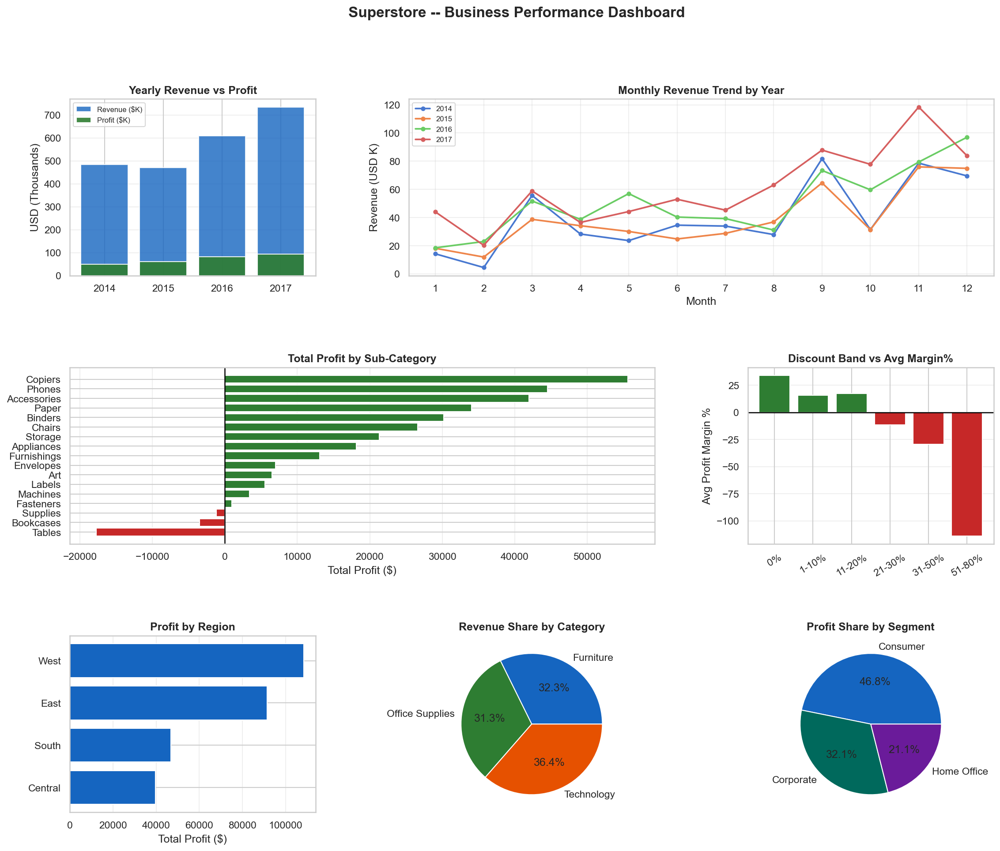
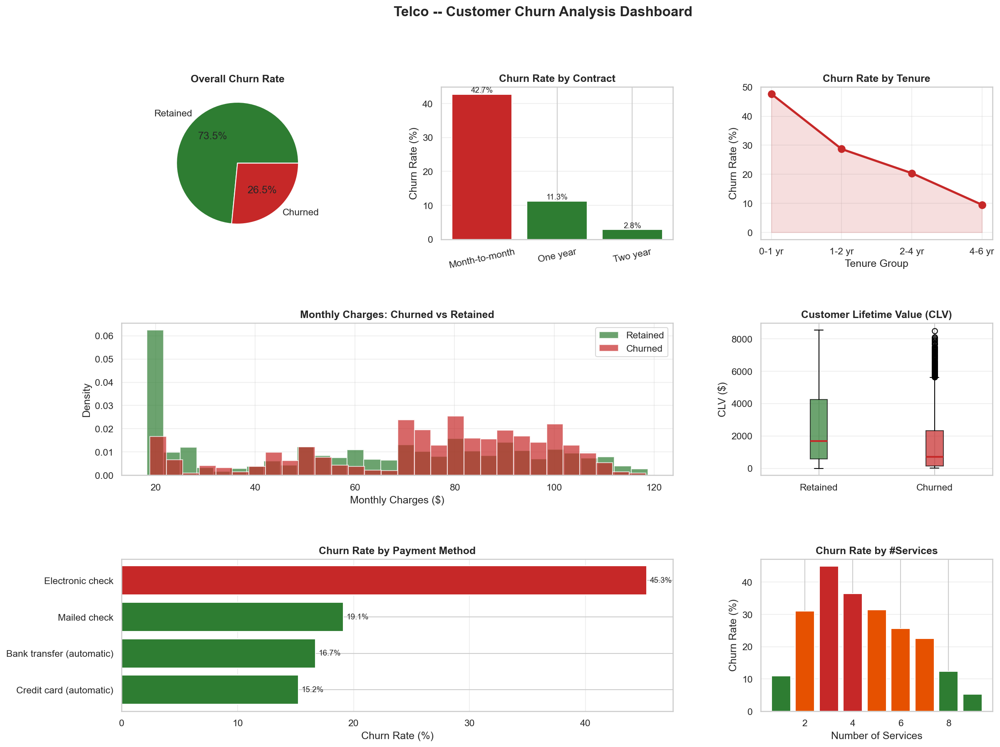

# Business Performance Analytics and Insight Generation

**End-to-end data analytics project:** cleaning, EDA, customer segmentation, machine learning and an interactive Power BI dashboard, applied to two real-world business problems: **retail profit leakage** and **telecom customer churn**.

`Python` `Pandas` `Scikit-learn` `Matplotlib` `Seaborn` `Power BI`

---

## Business Problems

| Domain | Dataset | Question |
|--------|---------|----------|
| Retail | Superstore Sales (9,994 transactions, 2014-2017) | Why are so many orders loss-making, and where does the profit leak? |
| Telecom | IBM Watson Telco Churn (7,043 customers) | Which customers are likely to leave, and what drives it? |

## What I Built

1. **Data pipeline:** loading and validation, cleaning (duplicates, missing values, type fixes), feature engineering (e.g. profit margin, discount bands, customer lifetime value, tenure groups).
2. **Exploratory analysis:** KPIs, yearly and monthly trends, category, region and sub-category profitability, churn breakdowns.
3. **RFM segmentation:** 793 customers grouped into 8 segments (Champions, At Risk, Lost, etc.), each with a suggested action.
4. **Predictive models:** Gradient Boosting classifiers for order profitability and customer churn, with stratified 5-fold cross-validation.
5. **Threshold tuning:** churn decision threshold lowered from 0.50 to 0.40 to catch more churners.
6. **Power BI dashboard:** 2 pages, KPI cards, charts and slicers for non-technical users.

## Key Findings

**Retail (Superstore)**
- Revenue $2.30M, profit $286K, overall margin 12.47%.
- About **18.7% of transactions are loss-making**; discounts above 20% push margins negative (51-80% discount band averages a -114% margin).
- Technology margin is 17.4%, while **Furniture is only 2.5%**. The Tables sub-category lost about $17.7K.
- Discount is the strongest driver in the profit model (about 73% feature importance).

**Telecom (Telco)**
- Overall churn is **26.5%**, with about $139K of monthly revenue at risk.
- Month-to-Month contracts churn at **42.7%** vs 2.8% for Two-Year contracts.
- First-year customers churn at 47.7%; Electronic Check payers at 45.3%.
- Retained customers have about 66% higher average lifetime value than churned ones.

## Model Performance

| Model | Accuracy | ROC-AUC | 5-Fold CV AUC |
|-------|----------|---------|---------------|
| Superstore profit classification | 94.95% | 0.986 | 0.988 ± 0.001 |
| Telco churn prediction | 78.50% | 0.840 | 0.840 ± 0.011 |

Telco churner recall improved from **50.3% to 62.3%** after threshold tuning (precision 59.0%), a deliberate trade-off because missing a churner costs far more than an unnecessary retention offer.

## Recommendations Generated

- Cap discounts at around 20% to stop the largest source of losses.
- Run immediate retention outreach for the 99 "At Risk" retail customers.
- Offer incentives to move Month-to-Month Telco customers to annual contracts.
- Add a structured onboarding programme for new Telco customers.

*(Financial impact figures in the full project report are estimates based on the dataset.)*

## Dashboard

**Superstore Business Performance (Power BI)**


**Telco Churn Analysis (Power BI)**


The dashboard file is available in the repository: `dashboard.pbix`

## Sample Python Outputs





## Skills Demonstrated

Data cleaning and preprocessing, feature engineering, exploratory data analysis, customer segmentation (RFM), classification modelling, model evaluation (ROC-AUC, confusion matrix, cross-validation), dashboard design in Power BI, and turning analysis into business recommendations.

## Repository Structure

```
├── main.py                                   # Menu-driven analytics pipeline
├── dashboard.pbix                            # Power BI dashboard
├── data/                                     # Raw datasets (Superstore, Telco)
├── outputs/                                  # Processed CSVs, predictions, plots
├── docs/                                     # Dashboard screenshots
└── test dataset/                             # Sample test files
```

## How to Run

```bash
git clone https://github.com/sirajnisha0604-prog/Business-Performance-Analytics-and-Insight-Generation.git
cd Business-Performance-Analytics-and-Insight-Generation
pip install pandas numpy scikit-learn matplotlib seaborn
python main.py
```

Choose an option from the menu to run a single module or the full pipeline. Outputs are saved in `outputs/`. To view the dashboard, open `dashboard.pbix` in Power BI Desktop and point the data sources to the CSV files in `outputs/` if needed.

## Authors

**Siraj Nisha S** | B.E. Computer Science and Engineering, University College of Engineering, Ramanathapuram (Anna University)
LinkedIn: `www.linkedin.com/in/siraj-nisha-363990209` | Email: `sirajnisha0604@gmail.com`

Co-author: Yamuna Devi R
Guide: Mr. R. Manikandan, Assistant Professor, Department of CSE
